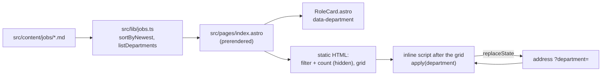

# Architecture Spine — Filter open roles by department

## Design Paradigm

**Static page, progressively enhanced.** Everything a visitor can filter is rendered at build time by Astro; one small browser script only shows and hides what is already on the page. The page works fully, as today, with no script.

Dependency direction: content → `src/lib` → page/components → inline script. The script reads only the DOM and the address; it imports nothing and is never imported.

## Invariants & Rules

### AD-1 — One helper derives the Departments

- **Binds:** FR-1
- **Prevents:** the option list and the cards' Departments disagreeing on whitespace, duplicates or order
- **Rule:** `listDepartments(jobs: Job[]): string[]` in `src/lib/jobs.ts` (trim, de-duplicate, sort with `localeCompare(…, 'en')`) is the only place the Department set is computed. The page renders the options from it. No other module or script derives the set.

### AD-2 — The card attribute is a card's Department; filtering only hides

- **Binds:** FR-2, FR-3
- **Prevents:** one change re-rendering or reordering cards while another expects them in place
- **Rule:** each Role card carries `data-department` with the trimmed Department, the same string `listDepartments` returns. Filtering sets or removes the `hidden` attribute on Role cards and never removes, re-renders, clones or reorders them.

### AD-3 — The address is the single source of truth [ADOPTED from PRD FR-4, FR-5]

- **Binds:** FR-2, FR-4, FR-5
- **Prevents:** the select, the visible cards and the address drifting apart after reload, Back/Forward or browser form-state restoration
- **Rule:** one `apply(department | null)` function sets the select's value, the cards' `hidden` and the count line together. It is called on load with the `department` query parameter read via `URLSearchParams`, which is checked against the rendered option values; an unknown value means `null`. The select's `change` handler writes the address with `history.replaceState` (set or delete `department`), then calls `apply`. Nothing else writes the select, the cards or the count. A `pageshow` event with `persisted` set calls `apply` again from the address.

### AD-4 — Enhancement ships hidden and runs before first paint

- **Binds:** FR-5, PRD §5
- **Prevents:** a visible but inert control without JavaScript, and non-matching cards flashing before a Filtered view applies
- **Rule:** the filter (a native `<select>` with a visible `<label>`) and the count line are in the static HTML with the `hidden` attribute. One self-contained `<script is:inline>`, placed directly after the roles grid in `index.astro`, unhides them and calls `apply`. It is not an Astro module script, which is deferred. No part of the filter is rendered when there are no Postings.

### AD-5 — One formatter for the count line

- **Binds:** FR-3
- **Prevents:** different count wording in different code paths
- **Rule:** the count line's text comes only from one function in the inline script: `"{n} open role"`, plus `"s"` when n ≠ 1, plus `" in {Department}"` when a Department is chosen. The count line is `aria-live="polite"`.

## Consistency Conventions

| Concern | Convention |
| --- | --- |
| Test hooks | `data-testid="department-filter"` on the select, `data-testid="roles-count"` on the count line; existing `role-card`, `roles-grid` unchanged |
| Query parameter | `department`, exact Department name, encoded and decoded only by `URLSearchParams` |
| Option values | All departments is the empty string `""`; each other option's value and label are the Department |
| Styling | Tailwind utility classes in the slate/blue palette already used by `RoleCard.astro` and `Tag.astro`; no new CSS file |
| Tests | Department derivation unit-tested in `src/lib/jobs.test.ts`; behaviour end-to-end in `e2e-tests/home.spec.ts`, with expected counts derived from `src/content/jobs` as that file already does |

## Stack

| Name | Version |
| --- | --- |
| Astro | ^7.4.12 `[ASSUMPTION]` from package.json |
| TypeScript (via `astro check`) | ^6.0.2 |
| Tailwind CSS | ^4.3.4 |
| Vitest | ^5.1.0 |
| Playwright + @axe-core/playwright | ^1.64.1 / ^4.14.0 |

No dependency is added.

## Capability → Architecture Map

| Capability | Lives in | Governed by |
| --- | --- | --- |
| FR-1 Offer the Departments | `src/lib/jobs.ts`, `src/pages/index.astro` | AD-1, AD-4 |
| FR-2 Narrow the listing | inline script in `index.astro`, `RoleCard.astro` | AD-2, AD-3 |
| FR-3 State how many roles are shown | inline script in `index.astro` | AD-5 |
| FR-4 Reflect the choice in the address | inline script in `index.astro` | AD-3 |
| FR-5 Open a Filtered view from its address | inline script in `index.astro` | AD-3, AD-4 |
| PRD §5 static site, works without JS | `index.astro` | Paradigm, AD-4 |

## Deferred

- **Deployment and environments:** unchanged. The listing stays in the static output, and the Node adapter still serves only `/api/apply`. Nothing here needs a server.
- **Observability and analytics:** none exist and the PRD rules them out.
- **Extracting the client logic into a typed module:** only worth it if a second filter arrives (PRD §6 non-goal). Until then the inline script is covered by the e2e tests.
- **Per-option counts and a filter-preserving detail-page back link:** PRD Open Questions 1 and 2.
